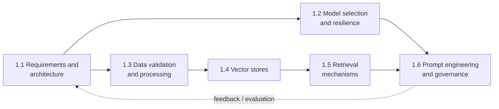

# Domain 1 — Foundation Model Integration, Data Management, and Compliance

**Weight:** 31% of scored content (✅ AIP-C01 exam guide), the largest domain.
**Course:** AWS Skill Builder, *Domain 1 Review* (≈1 h). It has a domain overview module plus six task modules. Each task module has the same lessons: How to Use · Overview · Review AWS Services · Review AWS Skills · Review Together (video + transcript) · Knowledge Check (5 questions) · Bonus Assignment.

📘 **Domain goal (course, paraphrased).** A GenAI developer works across the whole lifecycle: picks FMs, builds data pipelines, implements vector stores and retrieval, and designs prompt systems with governance and quality control. The course itself notes that it does not cover every service that may appear on the exam.

## Task inventory

| Task | Skills (from the course Overview lessons) | Code blocks in course | Status | Notes |
|---|---|---|---|---|
| [1.1 Analyze requirements and design GenAI solutions](Task-01/Study-Notes.md) | 3: architecture design (FMs, integration patterns, deployment) · Bedrock PoC · standardized components with WA Framework / GenAI Lens | 3 | ✅ Complete | |
| 1.2 Select and configure FMs | 4: benchmark-based FM selection · Lambda/API Gateway/AppConfig dynamic model switching · resilience (Step Functions circuit breaker, Cross-Region Inference, graceful degradation) · customization lifecycle (SageMaker, LoRA/adapters, Model Registry, rollback) | 12 | ⏳ Next | |
| 1.3 Implement data validation and processing pipelines | 4: Glue Data Quality / Data Wrangler / Lambda / CloudWatch validation · multimodal processing (Bedrock multimodal, SageMaker Processing, Transcribe) · input formatting (Bedrock JSON, SageMaker endpoints, dialog format) · enrichment (Bedrock reformatting, Comprehend entities, Lambda normalization) | 15 | Discovered | |
| 1.4 Design and implement vector store solutions | 5: vector DB architectures (KB, OpenSearch Neural plugin, RDS+S3, DynamoDB) · metadata frameworks · high-performance indexing (sharding, multi-index, hierarchical) · integration connectors · data maintenance and sync | 6 | Discovered | |
| 1.5 Design retrieval mechanisms for FM augmentation | 6: chunking strategies · embedding selection (Titan, batch generation) · vector search (OpenSearch, Aurora pgvector, KB) · hybrid search and rerankers · query expansion/decomposition/transformation · function calling / MCP access | 14 | Discovered | Packaged as SCORM, still readable |
| 1.6 Implement prompt engineering strategies and governance | 6: instruction frameworks (Prompt Management, Guardrails) · conversational context (Step Functions, Comprehend, DynamoDB) · governance (S3 repos, CloudTrail, CloudWatch Logs) · prompt QA and regression · iterative refinement (CoT, structured output, feedback) · Prompt Flows chains | 2 | Discovered | |

## How the tasks connect (concept map)

The consolidated domain guide (`Domain-Revision.md/.pdf`) and the integrated practice questions (`Domain-Practice-Questions.md`) will be created after all six tasks are processed.
