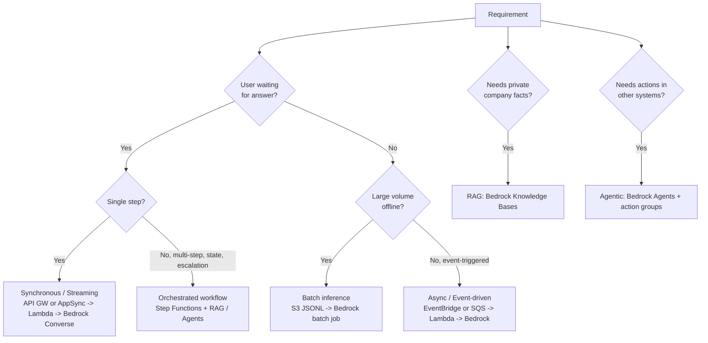
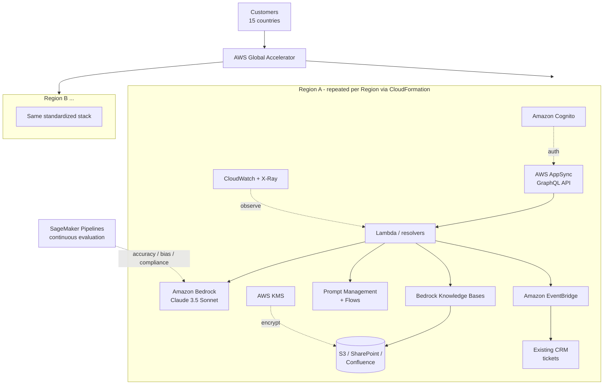
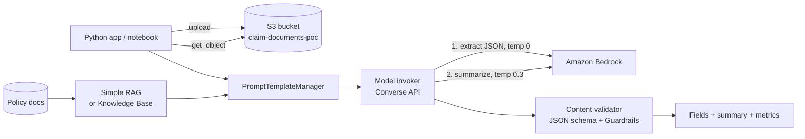
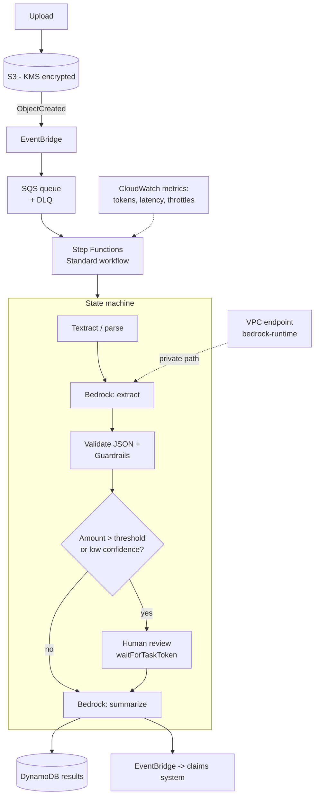
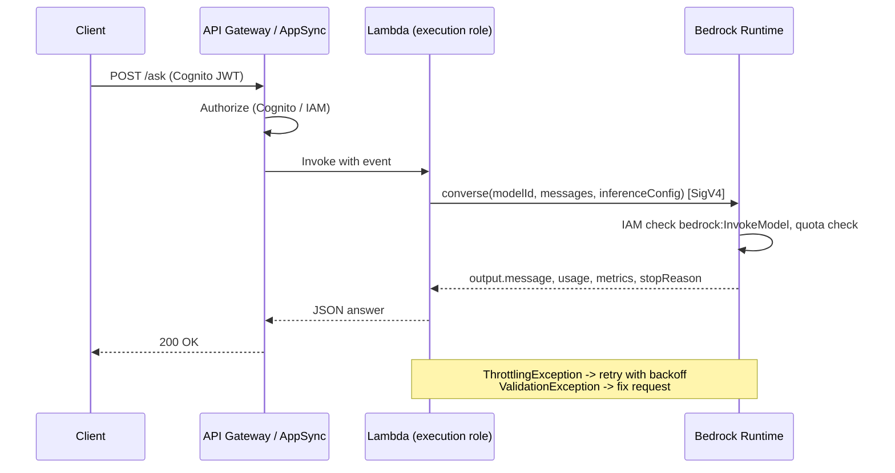
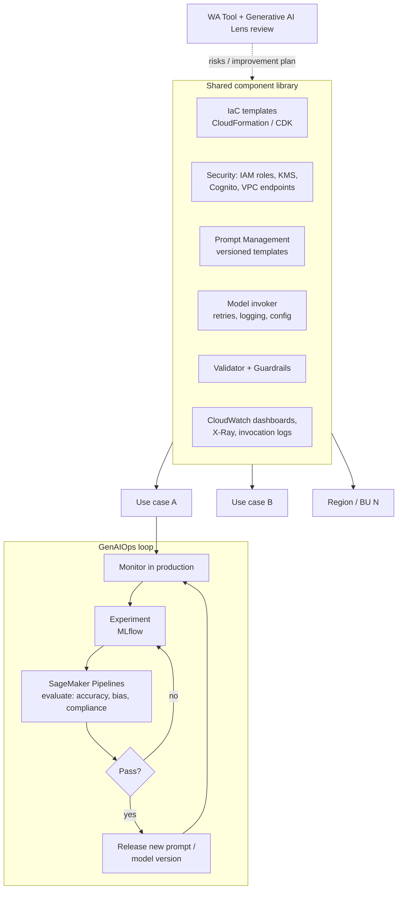

# Task 1.1 — Architecture Diagrams

Editable Mermaid diagrams. They render on GitHub, in VS Code (Mermaid extension), and in Obsidian. 📘 marks designs taken from the course; 🧠 marks illustrative designs built for learning. Back to [Study Notes](Study-Notes.md).

1. [Integration pattern map](#1-integration-pattern-map)
2. [Case study: multilingual financial assistant](#2-case-study-multilingual-financial-assistant)
3. [Bonus Assignment: claim-processing PoC](#3-bonus-assignment-claim-processing-poc)
4. [Production evolution: event-driven claim pipeline](#4-production-evolution-event-driven-claim-pipeline)
5. [Synchronous request/response sequence](#5-synchronous-requestresponse-sequence)
6. [Standardized components and GenAIOps loop](#6-standardized-components-and-genaiops-loop)

---

## 1. Integration pattern map

🧠 A decision flow for picking an integration pattern from the requirement wording.

**How to read it:** first decide whether the user waits for the answer, then how many steps the work has. RAG and agents are *added* to whichever pattern you picked; they are not alternatives to it.

---

## 2. Case study: multilingual financial assistant

📘 Reconstructed from the course "Review Together" transcript.

| Component | Role |
|---|---|
| Global Accelerator | Routes users to the nearest healthy Region (latency, resilience) |
| Cognito | Authenticates customers and agents |
| AppSync | GraphQL API layer: declarative fetching, built-in security |
| Lambda / resolvers | Business logic and prompt assembly |
| Bedrock (Claude 3.5 Sonnet) | Multilingual reasoning and generation |
| Knowledge Bases | Managed RAG over financial documents |
| Prompt Management / Flows | Versioned templates per query type and language; chains multi-step queries |
| EventBridge | Sends events to the CRM to create and update tickets |
| KMS / IAM | Encryption and fine-grained access |
| CloudWatch / X-Ray | Dashboards, alarms, tracing |
| SageMaker Pipelines | Automated accuracy, bias and compliance evaluation |
| CloudFormation | Deploys the same stack in every Region |

**Failure points:**

- **Bedrock throttling:** retries with backoff; cross-Region inference.
- **KB sync lag:** scheduled ingestion jobs.
- **CRM unavailability:** EventBridge retries + DLQ.
- **Regional outage:** Global Accelerator health checks fail over to another Region.

---

## 3. Bonus Assignment: claim-processing PoC

📘 Scope from the course; 🧠 layout.

**Data flow:**

1. Read the document.
2. Fill the template (adding retrieved policy context).
3. Bedrock call #1 extracts the fields.
4. Validate the JSON.
5. Bedrock call #2 writes the summary.
6. Return the results with token and latency metrics.

---

## 4. Production evolution: event-driven claim pipeline

🧠 How the PoC grows into a production design (the event-driven + orchestration pattern the course quiz rewards).

**Why this design:**

- SQS absorbs spikes and protects against Bedrock throttling.
- Step Functions gives retries, branching, human-in-the-loop and an audit trail.
- The VPC endpoint keeps traffic private.
- EventBridge decouples downstream systems.

---

## 5. Synchronous request/response sequence

🧠 What happens on the wire for one `Converse` call.

**Authentication chain:**

1. The user authenticates with Cognito.
2. The API authorizes the request.
3. Lambda assumes its execution role.
4. boto3 signs the request with SigV4.
5. Bedrock evaluates IAM (and SCPs/endpoint policies) before running the model.

---

## 6. Standardized components and GenAIOps loop

🧠 Built from the course's Skill 1.1.3 list.

